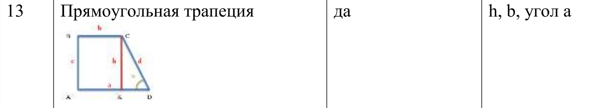
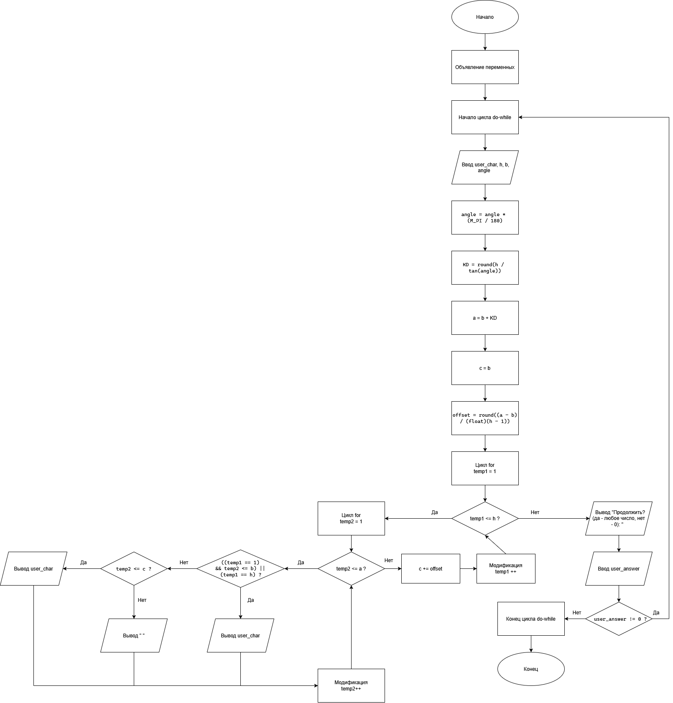

# Домашнее задание к работе 9

## Условие задачи
Задача А. Написать программу, выводящую на экран заданную геометрическую фигуру, нарисованную с помощью заданного с клавиатуры символа, условие заполнения фигуры и задаваемые параметры фигуры в таблице (остальные можно взять константные)

 

## 1. Алгоритм и блок-схема

### Алгоритм
1. **Начало**
2. Объявление переменных
   
  - char `user_char` - символ, из которого состоит фигура
  - int `h` - высота фигуры
  - int `b` - верхняя сторона
  - int `a` - нижняя сторона
  - int `KD` - нижний катет
  - int `c` - переменная для реализации отступов при печати фигуры
  - int `offset` - отступ на каждой итерации внешнего цикла for
  - float `angle` - угол
    
3. Начало цикла do-while
4. Ввод пользователем значений для `user_char`, `h`, `angle`, `b`
5. Перевод угла в радианы для последующих расчетов

  - `angle` = `angle` * (`M_PI` / 180)
    
6. Расчет `KD`

  - `KD` = round(`h` / tan(`angle`))
    
7. Расчет `a`

  - `a` = `b` + `KD`
    
8. Присваивание переменной `с` значение переменной `b`
   
  - `c` = `b`
    
9. Расчет `offset`
    
  - `offset` = round((`a` - `b`) / (float)(`h` - 1))
    
10. Внешний цикл for от 1 до `h` с шагом 1
    1. Внутренний цикл for от 1 до a с шагом 1
    1. Условный оператор if c условием (((`temp1` == 1) && `temp2` <= b) || (`temp1` == h))
    2. Условный оператор else
        1. Условный оператор if c условием (`temp2` <= `c`)
        2. Условный оператор else
    2. Конец внутреннего цикла
    3. Увеличение переменной `c`
     
		- `c` += `offset`
       
11. Конец внешнего цикла
12. Ввод пользователем числа для продолжения или остановки программы (продолжить - любое число, нет - 0)
13. Конец цикла do-while
14. **Конец**

### Блок-схема
 

## 2. Реализация программы

```
#define _CRT_SECURE_NO_WARNINGS
#define _USE_MATH_DEFINES
#include <stdio.h>
#include <locale.h>
#include <math.h>

int main() {
	setlocale(LC_CTYPE, "RUS");

	char user_char;
	int h, b, a, KD, c, offset;
	float angle;
	int user_answer;

	do
	{
		printf("Введите символ из которого будет состоять фигура: ");
		scanf(" %c", &user_char);
		printf("Введите высоту: ");
		scanf("%d", &h);
		printf("Введите сторону b: ");
		scanf("%d", &b);
		printf("Введите угол: ");
		scanf("%f", &angle);
		printf("\n");

		angle = angle * (M_PI / 180);

		KD = round(h / tan(angle));

		a = b + KD;

		c = b;

		offset = round((a - b) / (float)(h - 1));

		for (int temp1 = 1; temp1 <= h; temp1++) {

			for (int temp2 = 1; temp2 <= a; temp2++) {

				if (((temp1 == 1) && temp2 <= b) || (temp1 == h)) printf("%c", user_char);
				else
					if (temp2 <= c) printf("%c", user_char);
					else printf(" ");

			}

			c += offset;	

			printf("\n");
		}

		printf("\n");
		printf("Продолжить? (Да - любое число, нет - 0): ");
		scanf("%d", &user_answer);
	} 
	while (user_answer != 0);
	
	return 0;
}
```

## 3. Результаты работы программы

1. **Вывод программы на трех примерах, показана интерактивность программы**
```
Введите символ из которого будет состоять фигура: *
Введите высоту: 8
Введите сторону b: 8
Введите угол: 45

********
*********
**********
***********
************
*************
**************
****************

Продолжить? (Да - любое число, нет - 0): 1
Введите символ из которого будет состоять фигура: #
Введите высоту: 6
Введите сторону b: 5
Введите угол: 30

#####
#######
#########
###########
#############
###############

Продолжить? (Да - любое число, нет - 0): 5
Введите символ из которого будет состоять фигура: +
Введите высоту: 10
Введите сторону b: 15
Введите угол: 45

+++++++++++++++
++++++++++++++++
+++++++++++++++++
++++++++++++++++++
+++++++++++++++++++
++++++++++++++++++++
+++++++++++++++++++++
++++++++++++++++++++++
+++++++++++++++++++++++
+++++++++++++++++++++++++

Продолжить? (Да - любое число, нет - 0): 0
```

## 4. Информация о разработчике

Лупачев Сергей бТИИ-262
